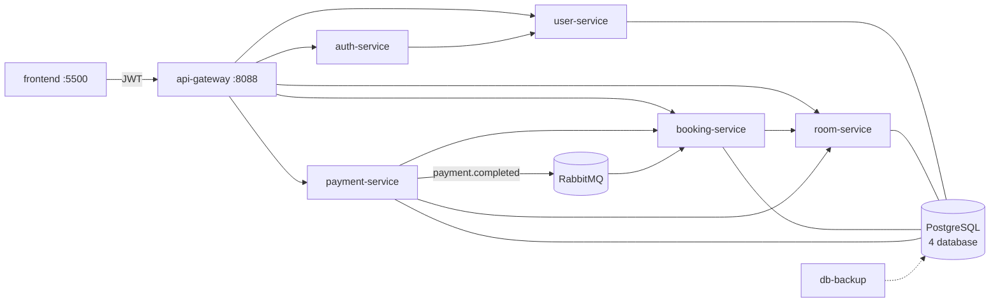

# Distributed Hotel Booking

Hệ thống đặt phòng khách sạn theo kiến trúc phân tán: 6 microservice Spring Boot, API Gateway kiểm tra JWT, RabbitMQ cho luồng sự kiện thanh toán, PostgreSQL với sao lưu tự động.

## Chạy hệ thống

Yêu cầu: Docker Desktop (không cần cài Java hay Maven, việc build diễn ra trong container).

```powershell
docker compose up -d --build
docker compose ps        # chờ tất cả service ở trạng thái (healthy), khoảng 1–2 phút
```

| Địa chỉ | Nội dung |
|---|---|
| http://localhost:5500 | Trang khách: đăng ký, đăng nhập, đặt phòng, thanh toán |
| http://localhost:5500/admin-login.html | Trang quản trị (`23010139@gmail.com` / `nht123456`) |
| http://localhost:8088/api | API Gateway |
| http://localhost:15672 | RabbitMQ Management (guest / guest) |

Dừng: `docker compose down` (giữ dữ liệu) hoặc `docker compose down -v` (xoá dữ liệu).

## Kiến trúc



## Tài liệu theo bảng chấm điểm

| Chương | Nội dung chính | Tài liệu |
|---|---|---|
| 1. Mở đầu | Bài toán, mục tiêu, yêu cầu, sơ đồ tổng thể | [chapter1](docs/chapter1-introduction.md) |
| 2. Kiến trúc | Microservices + event-driven, database-per-service, sơ đồ tuần tự/triển khai | [chapter2](docs/chapter2-architecture.md) |
| 3. Tiến trình & luồng | Container, healthcheck, restart, thread pool, consumer threads, `@Scheduled` tự huỷ booking | [chapter3](docs/chapter3-process-thread.md) |
| 4. Trao đổi thông tin | REST, RabbitMQ (topic exchange, DLQ) | [chapter4](docs/chapter4-communication.md) |
| 5. Định danh | Docker DNS, JWT kiểm tra tại Gateway, phân quyền, URI | [chapter5](docs/chapter5-identification.md) |
| 6. Đồng bộ hoá | Pessimistic lock chống đặt trùng, compare-and-set chống thanh toán 2 lần, `@Version`, consumer idempotent | [chapter6](docs/chapter6-synchronization.md) |
| 7. Sao lưu | PostgreSQL, `pg_dump` tự động, khôi phục | [chapter7](docs/chapter7-backup.md) |
| 8. Chịu lỗi | Health check, restart, timeout, retry, circuit breaker, fallback, DLQ | [chapter8](docs/chapter8-fault-tolerance.md) |
| Thuyết trình | Kịch bản demo từng chương | [demo](docs/demo.md) |

## Chạy một service riêng khi phát triển (không Docker)

Mỗi service vẫn chạy được độc lập với H2 in-memory (cần Java 17+ và Maven):

```bash
cd services/booking-service
mvn spring-boot:run
```

booking-service và payment-service cần RabbitMQ ở `localhost:5672` cho luồng sự kiện; thiếu RabbitMQ thì payment-service tự chuyển sang gọi REST.

## Cấu hình qua biến môi trường

Tạo file `.env` cạnh `docker-compose.yml` để ghi đè:

| Biến | Mặc định | Ý nghĩa |
|---|---|---|
| `POSTGRES_USER` / `POSTGRES_PASSWORD` | `hotel` / `hotel123` | Tài khoản PostgreSQL |
| `JWT_SECRET` | (chuỗi mẫu) | Khoá ký JWT, dùng chung auth-service và api-gateway |
| `BOOKING_PAYMENT_TIMEOUT_MINUTES` | `15` | Booking chưa thanh toán sau bao lâu thì tự huỷ |
| `BACKUP_INTERVAL_SECONDS` | `3600` | Chu kỳ sao lưu |
| `BACKUP_KEEP` | `24` | Số bản sao lưu giữ lại |
