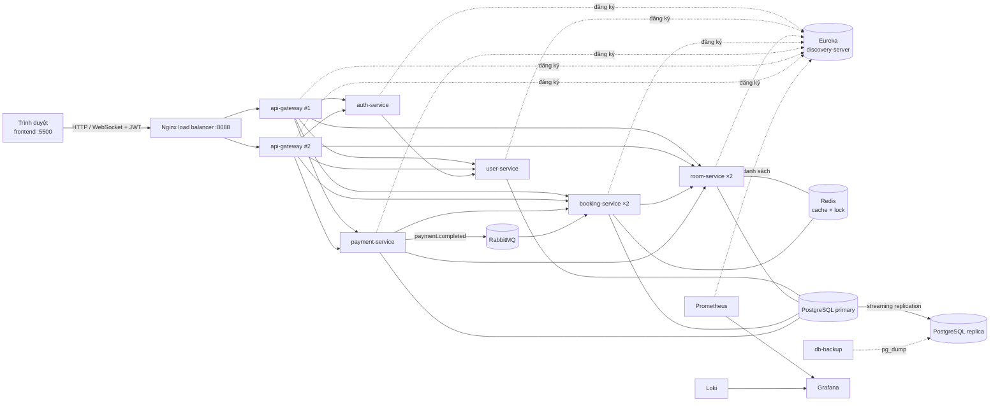

# Chương 1 – Mở đầu

## 1.1. Bài toán

Một khách sạn cần hệ thống đặt phòng trực tuyến: khách tìm phòng, đặt phòng theo khoảng ngày, thanh toán và xem lịch sử; quản trị viên theo dõi booking, phòng, người dùng và doanh thu.

Nếu làm một ứng dụng nguyên khối (monolith), mọi chức năng chạy chung một tiến trình và một database: một lỗi ở phần thanh toán có thể làm sập cả phần tìm phòng, và không thể mở rộng riêng phần chịu tải nặng. Vì vậy hệ thống được xây dựng theo mô hình **hệ thống phân tán**: tách thành nhiều service độc lập, chạy ở các tiến trình (container) riêng, giao tiếp qua mạng.

## 1.2. Mục tiêu

- Áp dụng kiến trúc **microservices** kết hợp **hướng sự kiện** (event-driven).
- Đảm bảo **không đặt trùng phòng** khi nhiều người đặt cùng lúc, kể cả khi chạy nhiều instance.
- **Định danh và phân quyền** người dùng bằng JWT tại một điểm vào duy nhất (API Gateway).
- Dữ liệu **bền vững và sao lưu tự động**, khôi phục được khi có sự cố.
- **Chịu lỗi**: một service chết không kéo sập các service khác.
- Toàn bộ hệ thống khởi động bằng **một lệnh** (`docker compose up`).

## 1.3. Phạm vi chức năng

| Vai trò | Chức năng |
|---|---|
| Khách | Đăng ký, đăng nhập, xem/tìm phòng, đặt phòng, thanh toán, xem lịch sử, huỷ booking |
| Quản trị viên | Xem thống kê, danh sách booking (kèm tên phòng, giá), duyệt/huỷ booking, xem phòng, người dùng, doanh thu |
| Hệ thống | Tự huỷ booking quá hạn thanh toán, tự sao lưu database định kỳ |

## 1.4. Yêu cầu phi chức năng

| Yêu cầu | Cách đáp ứng | Chương |
|---|---|---|
| Nhất quán khi đặt đồng thời | Khoá phân tán Redis (Redlock), dự phòng khoá database, compare-and-set, optimistic lock | 6 |
| Bảo mật | JWT, phân quyền ADMIN/CUSTOMER, chặn API nội bộ tại Gateway, phân quyền kênh WebSocket | 5 |
| Tách rời service | RabbitMQ cho luồng thanh toán, Eureka cho định vị service | 2, 4, 5 |
| Hiệu năng | Redis cache danh sách phòng | 4 |
| Thời gian thực | WebSocket (STOMP) báo trạng thái booking | 4 |
| Bền vững dữ liệu | PostgreSQL primary + replica, pg_dump tự động | 7 |
| Chịu lỗi, mở rộng | Nhiều instance, Nginx load balancer, Eureka + LoadBalancer, circuit breaker, retry, health check | 8 |
| Quan sát hệ thống | Prometheus + Grafana (metrics), Loki (log tập trung) | 8 |

## 1.5. Tổng quan hệ thống

## 1.6. Công nghệ

| Thành phần | Công nghệ |
|---|---|
| Service | Java 17, Spring Boot 3.2, Spring Data JPA |
| API Gateway | Spring Cloud Gateway (WebFlux) |
| Service registry, cân bằng tải | Netflix Eureka, Spring Cloud LoadBalancer, Nginx |
| Xác thực | JWT (jjwt), BCrypt |
| Message broker | RabbitMQ 3.13 |
| Cache, khoá phân tán | Redis 7.2, Redisson |
| Thời gian thực | WebSocket + STOMP |
| Database | PostgreSQL 16 (primary + replica), H2 khi chạy local |
| Chịu lỗi | Resilience4j, Spring Boot Actuator, Docker healthcheck + restart policy |
| Giám sát | Prometheus, Grafana, Loki, Promtail |
| Triển khai | Docker, Docker Compose |
| Frontend | HTML, CSS, JavaScript thuần, @stomp/stompjs |
