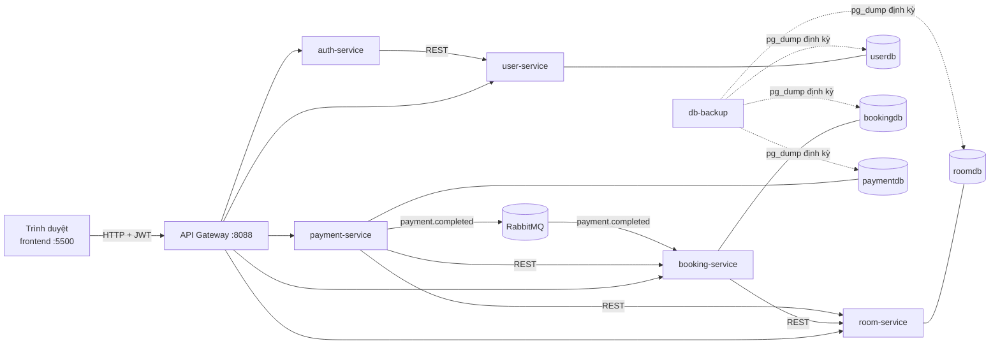

# Chương 1 – Mở đầu

## 1.1. Bài toán

Một khách sạn cần hệ thống đặt phòng trực tuyến: khách tìm phòng, đặt phòng theo khoảng ngày, thanh toán và xem lịch sử; quản trị viên theo dõi booking, phòng, người dùng và doanh thu.

Nếu làm một ứng dụng nguyên khối (monolith), mọi chức năng chạy chung một tiến trình và một database: một lỗi ở phần thanh toán có thể làm sập cả phần tìm phòng, và không thể mở rộng riêng phần chịu tải nặng. Vì vậy hệ thống được xây dựng theo mô hình **hệ thống phân tán**: tách thành nhiều service độc lập, chạy ở các tiến trình (container) riêng, giao tiếp qua mạng.

## 1.2. Mục tiêu

- Áp dụng kiến trúc **microservices** kết hợp **hướng sự kiện** (event-driven).
- Đảm bảo **không đặt trùng phòng** khi nhiều người đặt cùng lúc, kể cả khi chạy nhiều instance.
- **Định danh và phân quyền** người dùng bằng JWT tại một điểm vào duy nhất (API Gateway).
- Dữ liệu **bền vững và sao lưu tự động**, khôi phục được khi có sự cố.
- **Chịu lỗi**: một service chết không kéo sập các service khác.
- Toàn bộ hệ thống khởi động bằng **một lệnh** (`docker compose up`).

## 1.3. Phạm vi chức năng

| Vai trò | Chức năng |
|---|---|
| Khách | Đăng ký, đăng nhập, xem/tìm phòng, đặt phòng, thanh toán, xem lịch sử, huỷ booking |
| Quản trị viên | Xem thống kê, danh sách booking (kèm tên phòng, giá), duyệt/huỷ booking, xem phòng, người dùng, doanh thu |
| Hệ thống | Tự huỷ booking quá hạn thanh toán, tự sao lưu database định kỳ |

## 1.4. Yêu cầu phi chức năng

| Yêu cầu | Cách đáp ứng | Chương |
|---|---|---|
| Nhất quán khi đặt đồng thời | Pessimistic lock theo phòng, compare-and-set, optimistic lock | 6 |
| Bảo mật | JWT, phân quyền ADMIN/CUSTOMER, chặn API nội bộ tại Gateway | 5 |
| Tách rời service | RabbitMQ cho luồng thanh toán → xác nhận booking | 2, 4 |
| Bền vững dữ liệu | PostgreSQL + pg_dump tự động | 7 |
| Chịu lỗi | Health check, tự khởi động lại, circuit breaker, retry, timeout, fallback, dead-letter queue | 8 |

## 1.5. Tổng quan hệ thống

## 1.6. Công nghệ

| Thành phần | Công nghệ |
|---|---|
| Service | Java 17, Spring Boot 3.2, Spring Data JPA |
| API Gateway | Spring Cloud Gateway (WebFlux) |
| Xác thực | JWT (jjwt), BCrypt |
| Message broker | RabbitMQ 3.13 |
| Database | PostgreSQL 16 (Docker), H2 (chạy local khi phát triển) |
| Chịu lỗi | Resilience4j, Spring Boot Actuator, Docker healthcheck + restart policy |
| Triển khai | Docker, Docker Compose, Nginx (frontend) |
| Frontend | HTML, CSS, JavaScript thuần |
