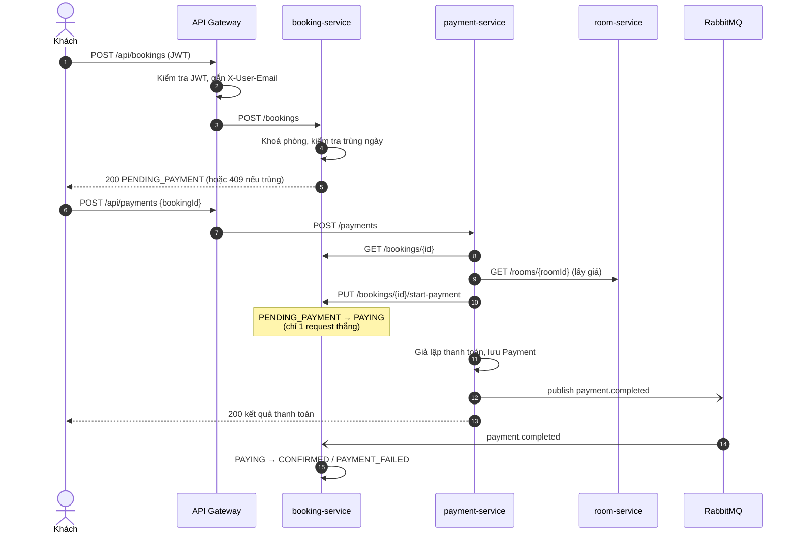
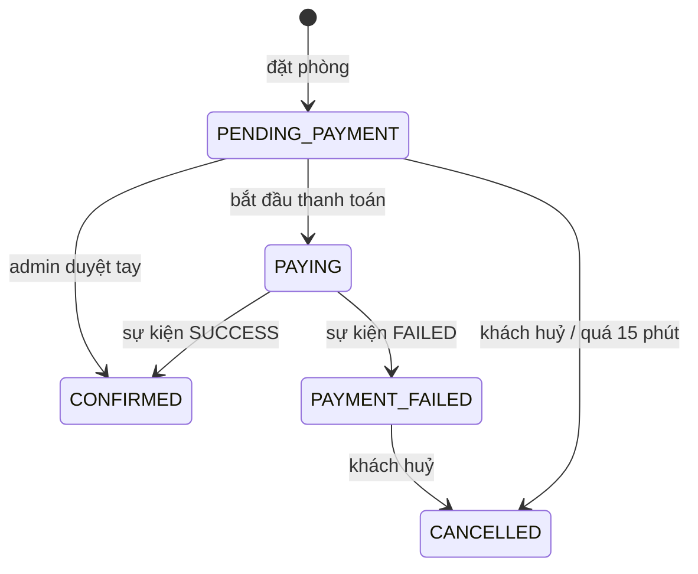
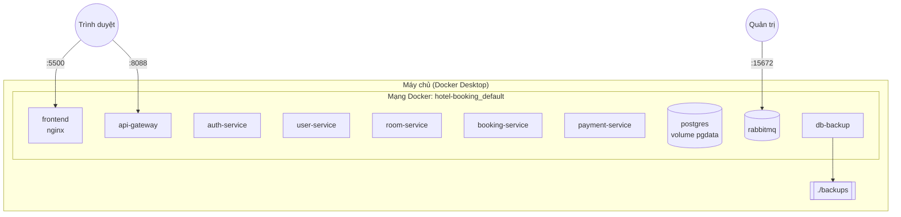

# Chương 2 – Kiến trúc

## 2.1. Kiểu kiến trúc

Hệ thống kết hợp hai kiểu kiến trúc:

- **Microservices**: mỗi nghiệp vụ là một service độc lập, có database riêng, build và triển khai riêng.
- **Hướng sự kiện (event-driven)**: khi thanh toán xong, payment-service không gọi booking-service mà **phát sự kiện** `payment.completed` lên RabbitMQ; booking-service tự lắng nghe và cập nhật. Hai service không cần cùng sống tại một thời điểm.

## 2.2. Các thành phần (node)

| Node | Cổng | Trách nhiệm | Dữ liệu sở hữu |
|---|---|---|---|
| frontend (Nginx) | 5500 | Phục vụ giao diện web | – |
| api-gateway | 8088 | Cửa vào duy nhất: định tuyến, xác thực JWT, phân quyền, CORS | – |
| auth-service | 8080 | Đăng nhập, cấp JWT | – |
| user-service | 8081 | Đăng ký, quản lý người dùng, mã hoá mật khẩu | `userdb` |
| booking-service | 8082 | Đặt/huỷ phòng, chống trùng lịch, nhận sự kiện thanh toán, tự huỷ booking quá hạn | `bookingdb` |
| room-service | 8083 | Danh sách phòng, giá | `roomdb` |
| payment-service | 8084 | Thanh toán, doanh thu, phát sự kiện | `paymentdb` |
| postgres | 5432 (nội bộ) | 4 database tách biệt | – |
| rabbitmq | 5672, 15672 | Message broker | Hàng đợi sự kiện |
| db-backup | – | Sao lưu định kỳ | Thư mục `./backups` |

Chỉ **frontend**, **api-gateway** và giao diện quản trị RabbitMQ mở cổng ra ngoài. Các service còn lại chỉ truy cập được bên trong mạng Docker.

## 2.3. Database-per-service

Mỗi service chỉ đọc/ghi database của chính nó. Khi cần dữ liệu của service khác, phải gọi API của service đó (ví dụ booking-service cần tên phòng thì gọi room-service). Nhờ vậy có thể đổi cấu trúc bảng của một service mà không ảnh hưởng service khác.

## 2.4. Phân chia công việc giữa các node – luồng đặt phòng và thanh toán

Bước 13–15 là **bất đồng bộ**: khách nhận kết quả ngay, booking được xác nhận ngay sau đó (thường dưới 1 giây). Đây là **nhất quán cuối cùng** (eventual consistency).

## 2.5. Vòng đời trạng thái booking

## 2.6. Sơ đồ triển khai

## 2.7. So sánh với kiến trúc trước khi cải tiến

| Tiêu chí | Ban đầu | Hiện tại |
|---|---|---|
| Xác nhận booking sau thanh toán | Gọi REST đồng bộ qua Gateway | Sự kiện RabbitMQ (fallback REST) |
| Địa chỉ service | `localhost` ghi cứng | Biến môi trường + Docker DNS |
| Database | H2 in-memory, mất khi tắt | PostgreSQL, volume bền vững |
| Bảo vệ API | Gateway không kiểm tra token | Gateway kiểm tra JWT + phân quyền |
| Triển khai | Chạy tay từng service | `docker compose up` |
