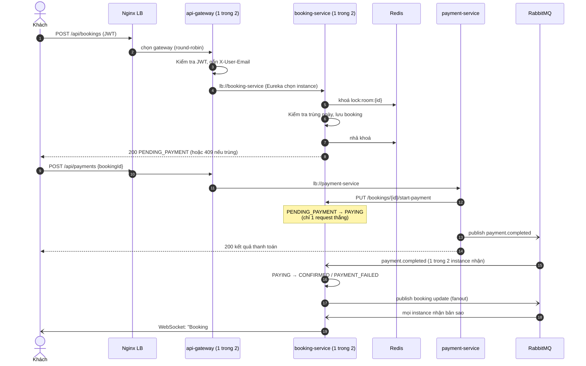
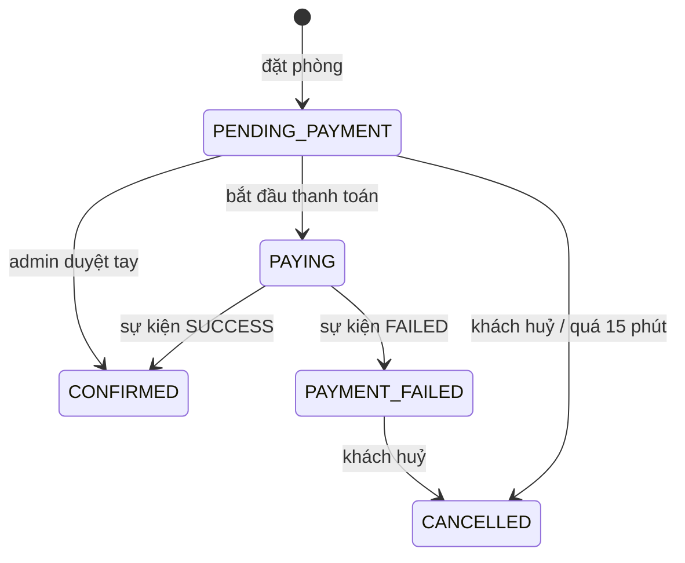
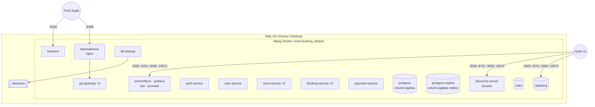

# Chương 2 – Kiến trúc

## 2.1. Kiểu kiến trúc

Hệ thống kết hợp hai kiểu kiến trúc:

- **Microservices**: mỗi nghiệp vụ là một service độc lập, có database riêng, build và triển khai riêng, chạy được nhiều bản sao (instance).
- **Hướng sự kiện (event-driven)**: khi thanh toán xong, payment-service không gọi booking-service mà **phát sự kiện** `payment.completed` lên RabbitMQ; booking-service tự lắng nghe và cập nhật. Thay đổi trạng thái booking cũng được phát qua RabbitMQ để mọi instance đẩy thông báo WebSocket tới trình duyệt.

## 2.2. Các thành phần (node)

| Node | Số instance | Trách nhiệm | Dữ liệu sở hữu |
|---|---|---|---|
| frontend (Nginx) | 1 | Phục vụ giao diện web, cổng 5500 | – |
| load-balancer (Nginx) | 1 | Cửa vào duy nhất cổng 8088, chia tải + failover giữa các api-gateway | – |
| api-gateway | **2** | Định tuyến theo Eureka, xác thực JWT, phân quyền, CORS, retry | – |
| discovery-server (Eureka) | 1 | Danh bạ: instance nào của service nào đang sống ở IP/cổng nào | Bảng đăng ký trong bộ nhớ |
| auth-service | 1 | Đăng nhập, cấp JWT | – |
| user-service | 1 | Đăng ký, quản lý người dùng, mã hoá mật khẩu | `userdb` |
| room-service | **2** | Danh sách phòng, giá; cache Redis | `roomdb` |
| booking-service | **2** | Đặt/huỷ phòng, khoá phân tán, nhận sự kiện thanh toán, WebSocket, tự huỷ booking quá hạn | `bookingdb` |
| payment-service | 1 | Thanh toán, doanh thu, phát sự kiện | `paymentdb` |
| postgres / postgres-replica | 1 + 1 | Primary nhận ghi; replica bản sao chỉ đọc | 4 database |
| rabbitmq | 1 | Message broker | Hàng đợi sự kiện |
| redis | 1 | Cache + khoá phân tán | Dữ liệu tạm |
| db-backup | 1 | pg_dump định kỳ từ replica | `./backups` |
| prometheus, grafana, loki, promtail | 1 mỗi loại | Thu thập metrics, log; hiển thị dashboard | – |

Tổng cộng **21 container**. Chỉ frontend (5500), load-balancer (8088) và các giao diện quản trị (Eureka 8761, Grafana 3000, Prometheus 9090, RabbitMQ 15672) mở cổng ra ngoài.

## 2.3. Database-per-service

Mỗi service chỉ đọc/ghi database của chính nó. Khi cần dữ liệu của service khác, phải gọi API của service đó (ví dụ booking-service cần tên phòng thì gọi room-service). Các instance của **cùng một service** dùng chung database của service đó.

## 2.4. Phân chia công việc giữa các node – luồng đặt phòng và thanh toán

Bước xác nhận là **bất đồng bộ**: khách nhận kết quả thanh toán ngay, booking được xác nhận ngay sau đó (thường dưới 1 giây) và trình duyệt được báo qua WebSocket. Đây là **nhất quán cuối cùng** (eventual consistency).

## 2.5. Vòng đời trạng thái booking

## 2.6. Sơ đồ triển khai

## 2.7. So sánh với kiến trúc ban đầu

| Tiêu chí | Ban đầu | Hiện tại |
|---|---|---|
| Xác nhận booking sau thanh toán | Gọi REST đồng bộ qua Gateway | Sự kiện RabbitMQ (fallback REST) |
| Định vị service | `localhost` ghi cứng | Eureka service registry |
| Số instance | 1 mỗi service | gateway, room, booking chạy 2 instance, có load balancer |
| Database | H2 in-memory, mất khi tắt | PostgreSQL primary + replica |
| Bảo vệ API | Gateway không kiểm tra token | Gateway kiểm tra JWT + phân quyền |
| Cập nhật giao diện | Phải tải lại trang | WebSocket đẩy thông báo |
| Giám sát | Không có | Prometheus, Grafana, Loki |
| Triển khai | Chạy tay từng service | `docker compose up` |
