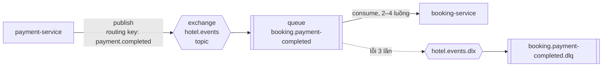

# Chương 4 – Trao đổi thông tin

Hệ thống dùng hai phương thức giao tiếp, chọn theo tính chất từng tình huống.

## 4.1. REST API (đồng bộ)

Dùng khi bên gọi **cần câu trả lời ngay** để làm bước tiếp theo.

| Bên gọi | Bên nhận | API | Lý do cần đồng bộ |
|---|---|---|---|
| Trình duyệt | api-gateway | `/api/**` | Người dùng chờ kết quả |
| api-gateway | 5 service | định tuyến theo đường dẫn, bỏ tiền tố `/api` | – |
| auth-service | user-service | `GET /users/by-email` | Cần mật khẩu đã băm để so khớp |
| booking-service | room-service | `GET /rooms/{id}` | Hiển thị tên/giá phòng cho admin |
| payment-service | booking-service | `GET /bookings/{id}`, `PUT /bookings/{id}/start-payment` | Phải biết booking hợp lệ trước khi thu tiền |
| payment-service | room-service | `GET /rooms/{id}` | Giá do backend quyết định, không tin client |

Service gọi nhau **trực tiếp** bằng tên trong mạng Docker (`http://booking-service:8082`), không vòng qua Gateway. Mọi lời gọi có **timeout** (kết nối 2s, đọc 3s).

## 4.2. Message Queue – RabbitMQ (bất đồng bộ)

Dùng khi bên gửi **chỉ cần thông báo một việc đã xảy ra**, không cần chờ bên nhận xử lý.



Nội dung message (JSON):

```json
{ "paymentId": 7, "bookingId": 3, "status": "SUCCESS", "amount": 1250000.0 }
```

| Thiết kế | Mục đích |
|---|---|
| Exchange kiểu **topic** | Sau này service khác (ví dụ gửi email) chỉ cần tạo queue mới và bind vào `payment.*`, không phải sửa payment-service |
| Queue **durable** | RabbitMQ khởi động lại không mất message chưa xử lý |
| **Retry 3 lần** rồi chuyển sang **dead-letter queue** | Message lỗi không bị lặp vô hạn, cũng không mất: vẫn nằm trong DLQ để kiểm tra |
| Consumer **idempotent** | Nhận trùng một message thì lần sau không làm gì (xem Chương 6) |
| **Fallback REST** khi không gửi được message | Xem Chương 8 |

Giao diện quản trị RabbitMQ: http://localhost:15672 (guest / guest) – xem exchange, queue, số message.

## 4.3. So sánh

| | REST | RabbitMQ |
|---|---|---|
| Kiểu | Đồng bộ, request–response | Bất đồng bộ, publish–subscribe |
| Bên nhận tạm chết | Bên gọi nhận lỗi ngay | Message nằm chờ trong queue, xử lý khi bên nhận sống lại |
| Phụ thuộc | Bên gọi phải biết địa chỉ bên nhận | Bên gửi chỉ biết exchange |
| Dùng trong hệ thống | Truy vấn dữ liệu, giữ quyền thanh toán | Thông báo kết quả thanh toán |
