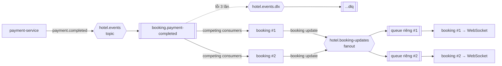

# Chương 4 – Trao đổi thông tin

Hệ thống dùng bốn phương thức giao tiếp, chọn theo tính chất từng tình huống.

| Phương thức | Công nghệ | Dùng cho |
|---|---|---|
| REST API (đồng bộ) | HTTP/JSON, Spring Cloud LoadBalancer | Truy vấn dữ liệu, giữ quyền thanh toán |
| Message queue (bất đồng bộ) | RabbitMQ | Kết quả thanh toán, phát thay đổi booking tới mọi instance |
| Real-time | WebSocket + STOMP | Báo trạng thái booking lên trình duyệt |
| Caching | Redis | Danh sách phòng |

## 4.1. REST API (đồng bộ)

Dùng khi bên gọi **cần câu trả lời ngay** để làm bước tiếp theo.

| Bên gọi | Bên nhận | API | Lý do cần đồng bộ |
|---|---|---|---|
| Trình duyệt | Nginx → api-gateway | `/api/**` | Người dùng chờ kết quả |
| api-gateway | 5 service | định tuyến `lb://<service>`, bỏ tiền tố `/api` | – |
| auth-service | user-service | `GET /users/by-email` | Cần mật khẩu đã băm để so khớp |
| booking-service | room-service | `GET /rooms/{id}` | Hiển thị tên/giá phòng cho admin |
| payment-service | booking-service | `GET /bookings/{id}`, `PUT /bookings/{id}/start-payment` | Phải biết booking hợp lệ trước khi thu tiền |
| payment-service | room-service | `GET /rooms/{id}` | Giá do backend quyết định, không tin client |

Service gọi nhau **trực tiếp** bằng tên logic (`http://room-service/rooms/1`). `RestTemplate` có `@LoadBalanced`: Spring Cloud LoadBalancer hỏi Eureka danh sách instance rồi chọn xoay vòng (Chương 5, 8). Mọi lời gọi có **timeout** (kết nối 0,5s, đọc 3s).

## 4.2. Message Queue – RabbitMQ (bất đồng bộ)

Dùng khi bên gửi **chỉ cần thông báo một việc đã xảy ra**, không cần chờ bên nhận xử lý.



Hai mẫu giao tiếp khác nhau:

| | `payment.completed` | `hotel.booking-updates` |
|---|---|---|
| Exchange | topic | fanout |
| Queue | 1 queue chung, durable | mỗi instance 1 queue riêng, tự xoá khi tắt |
| Ai nhận | **Một** instance (competing consumers): mỗi thanh toán chỉ xử lý một lần | **Mọi** instance: instance nào cũng phải đẩy tới client của mình |
| Mục đích | Cập nhật database | Thông báo WebSocket |

Nội dung message thanh toán (JSON):

```json
{ "paymentId": 7, "bookingId": 3, "status": "SUCCESS", "amount": 1250000.0 }
```

| Thiết kế | Mục đích |
|---|---|
| Exchange kiểu **topic** | Service khác (ví dụ gửi email) chỉ cần tạo queue mới và bind vào `payment.*` |
| Queue **durable** | RabbitMQ khởi động lại không mất message chưa xử lý |
| **Retry 3 lần** rồi chuyển sang **dead-letter queue** | Message lỗi không lặp vô hạn, cũng không mất |
| Consumer **idempotent** | Nhận trùng một message thì lần sau không làm gì (Chương 6) |
| **Fallback REST** khi không gửi được message | Chương 8 |

Giao diện quản trị: http://localhost:15672 (guest / guest).

## 4.3. Real-time – WebSocket (STOMP)

Trước đây khách phải tải lại trang để biết booking đã được xác nhận chưa. Giờ trình duyệt giữ một kết nối WebSocket và server **chủ động đẩy** thông báo.

- Kết nối: `ws://localhost:8088/ws?access_token=<JWT>`, đi qua Nginx → api-gateway → booking-service (route `lb:ws://booking-service`).
- Kênh:

| Kênh | Ai được nghe | Trang dùng |
|---|---|---|
| `/topic/user.{email}` | Chỉ đúng người dùng đó | Lịch sử đặt phòng |
| `/topic/admin.bookings` | Chỉ ADMIN | Trang quản trị |

- Khi booking đổi trạng thái (tạo, bắt đầu thanh toán, xác nhận, thất bại, huỷ), trình duyệt hiện thông báo góc màn hình và tự tải lại danh sách. Góc trái dưới có nhãn **● Cập nhật trực tiếp**.
- Instance booking-service mà trình duyệt đang nối bị tắt: thư viện STOMP tự nối lại sau 3 giây, Nginx/Gateway đưa sang instance còn sống.

**Kết quả kiểm thử**: alice và admin cùng nghe, alice đặt phòng rồi thanh toán, cả hai nhận đủ 3 thông báo:

```
MESSAGE {"id":3,"roomId":11,"userEmail":"alice@test.com","status":"PENDING_PAYMENT",...}
MESSAGE {"id":3,"roomId":11,"userEmail":"alice@test.com","status":"PAYING",...}
MESSAGE {"id":3,"roomId":11,"userEmail":"alice@test.com","status":"CONFIRMED",...}
```

## 4.4. Caching – Redis

Danh sách phòng gần như không đổi nhưng được đọc mỗi lần khách mở trang đặt phòng. room-service dùng `@Cacheable` với Redis:

| Cache | Khoá | Nội dung |
|---|---|---|
| `rooms` | `all` | Toàn bộ phòng |
| `roomSearch` | sức chứa | Kết quả tìm phòng |
| `room` | id | Một phòng (booking/payment-service gọi) |

- Thời gian sống 10 phút. Redis **dùng chung**, nên instance room-service #1 đọc từ DB thì instance #2 cũng hưởng cache.
- Redis chết: lỗi cache chỉ ghi log, request đọc thẳng PostgreSQL (Chương 8).

**Kết quả kiểm thử** (xoá cache rồi gọi 4 lần `GET /api/rooms`):

```
#1: 0.159s   ← cache miss, truy vấn database
#2: 0.019s   ← từ Redis
#3: 0.011s
#4: 0.013s
```

Grafana có panel "Redis cache phòng: hit / miss".

## 4.5. So sánh

| | REST | RabbitMQ | WebSocket |
|---|---|---|---|
| Kiểu | Đồng bộ, request–response | Bất đồng bộ, publish–subscribe | Hai chiều, kết nối giữ lâu |
| Bên nhận tạm chết | Bên gọi nhận lỗi (có retry sang instance khác) | Message chờ trong queue | Client tự nối lại |
| Dùng trong hệ thống | Truy vấn, giữ quyền thanh toán | Kết quả thanh toán, phát thay đổi | Đẩy thông báo lên trình duyệt |
