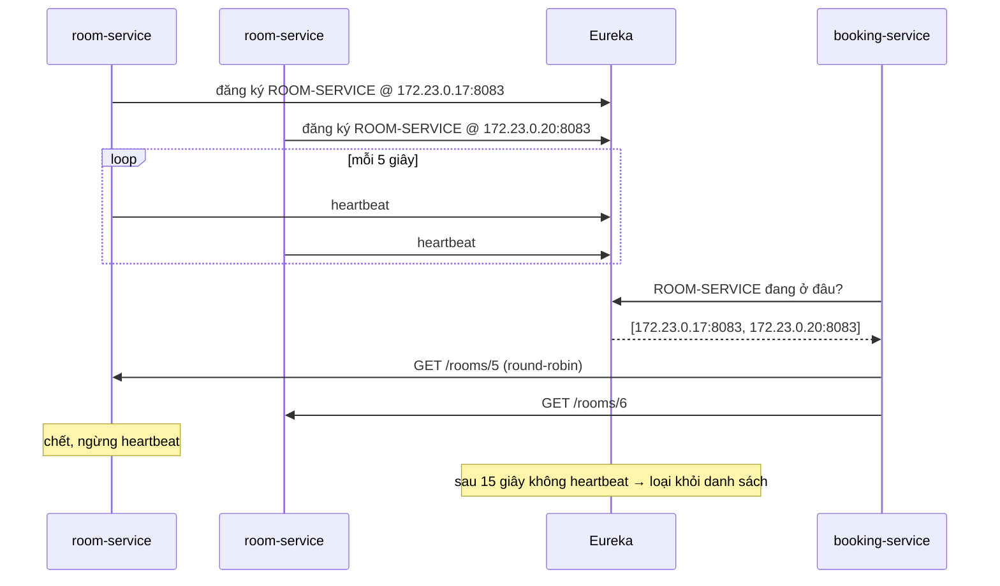
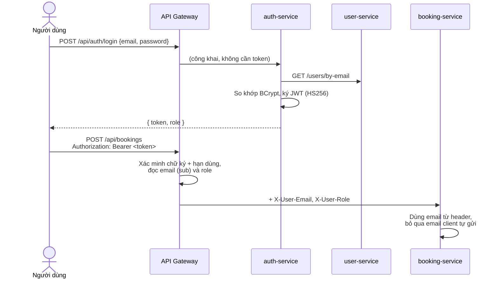

# Chương 5 – Định danh

Hệ thống định danh ở bốn mức: **node hạ tầng** (DNS), **instance service** (Eureka), **người dùng** (JWT) và **tài nguyên** (URI).

## 5.1. Định danh node hạ tầng: DNS trong mạng Docker

Mỗi container được Docker cấp một **tên miền nội bộ** trùng tên service. Các thành phần hạ tầng có vị trí cố định được gọi bằng tên này: `postgres`, `postgres-replica`, `rabbitmq`, `redis`, `discovery-server`, `loki`. Tên `api-gateway` phân giải ra IP của **cả 2** instance gateway; Nginx dùng điều này để chia tải (Chương 8).

## 5.2. Định danh và định vị service: Eureka Service Registry

Khi có nhiều instance của cùng một service, IP thay đổi mỗi lần khởi động lại, và instance có thể chết bất cứ lúc nào, nên tên tĩnh không đủ. Hệ thống dùng **Netflix Eureka** ([discovery-server](../services/discovery-server)):



| Thiết lập | Giá trị | Ý nghĩa |
|---|---|---|
| `lease-renewal-interval-in-seconds` | 5 | Instance gửi heartbeat mỗi 5 giây |
| `lease-expiration-duration-in-seconds` | 15 | Không thấy heartbeat 15 giây thì coi là chết |
| `eviction-interval-timer-in-ms` (server) | 5000 | Eureka dọn instance chết mỗi 5 giây |
| `spring.cloud.loadbalancer.cache.ttl` | 5s | Bên gọi làm mới danh sách mỗi 5 giây |
| `prefer-ip-address` | true | Đăng ký bằng IP container |

Cách dùng trong code:

- api-gateway định tuyến `uri: lb://booking-service` thay vì `http://localhost:8082`.
- Service gọi nhau qua `RestTemplate` có `@LoadBalanced`: `http://room-service/rooms/{id}`.
- **Prometheus cũng hỏi Eureka** (`eureka_sd_configs`) để biết cần thu thập metrics từ những instance nào (Chương 8).

Giao diện Eureka: http://localhost:8761. Kết quả thực tế:

```
API-GATEWAY      2  ['172.23.0.12', '172.23.0.9']
BOOKING-SERVICE  2  ['172.23.0.16', '172.23.0.15']
ROOM-SERVICE     2  ['172.23.0.20', '172.23.0.17']
PAYMENT-SERVICE  1  ['172.23.0.13']
AUTH-SERVICE     1  ['172.23.0.10']
USER-SERVICE     1  ['172.23.0.14']
```

## 5.3. Định danh người dùng: JWT



Nội dung token: `sub` = email, `role` = `ADMIN` / `CUSTOMER`, `exp` = 1 giờ. auth-service và **cả hai** instance api-gateway dùng chung khoá `JWT_SECRET`, nên token do instance nào cấp cũng được instance nào kiểm tra (xác thực không trạng thái – stateless).

## 5.4. Kiểm tra quyền tại Gateway

[JwtAuthFilter.java](../services/api-gateway/src/main/java/com/example/apigateway/security/JwtAuthFilter.java) phân loại mọi request:

| Loại | Đường dẫn | Không token | Token CUSTOMER | Token ADMIN |
|---|---|---|---|---|
| Công khai | `/api/auth/**`, `POST /api/users`, `GET /api/rooms/**` | ✅ | ✅ | ✅ |
| Cần đăng nhập | các API còn lại, `/ws` | 401 | ✅ | ✅ |
| Quản trị | `GET /api/users`, `GET /api/bookings`, `/api/bookings/admin`, `PUT /api/bookings/*/confirm`, `/api/payments/revenue/**` | 401 | 403 | ✅ |
| Nội bộ | `/api/bookings/*/start-payment`, `/api/bookings/*/fail` | 403 | 403 | 403 |

- Gateway **xoá** mọi header `X-User-Email`/`X-User-Role` client tự gửi rồi mới gắn giá trị lấy từ token, nên không giả mạo được danh tính.
- booking-service dùng danh tính này để: ghi đúng chủ booking, chỉ trả lịch sử của chính người dùng, không cho huỷ booking của người khác.
- **WebSocket**: trình duyệt không gắn được header khi mở WebSocket, nên token đi qua `?access_token=`. booking-service chỉ cho đăng ký `/topic/user.{email}` đúng email trong token, và `/topic/admin.bookings` khi role là ADMIN.

Kết quả kiểm thử:

```
GET bookings/active (không token):     401
GET users bằng token CUSTOMER:         403
GET users bằng token ADMIN:            200
PUT start-payment từ bên ngoài:        403
bob huỷ booking của alice:             403
alice đăng ký /topic/admin.bookings:   ERROR Không có quyền đăng ký kênh
alice đăng ký /topic/user.bob@...:     ERROR Không có quyền đăng ký kênh
```

## 5.5. Định danh tài nguyên: URI

Mỗi tài nguyên có một URI duy nhất kiểu REST: `/api/rooms/{id}`, `/api/bookings/{id}`, `/api/payments`. Khoá chính do database cấp; mỗi service quản lý khoá của bảng mình. Khoá phân tán trong Redis cũng được định danh theo tài nguyên: `lock:room:{id}`.
