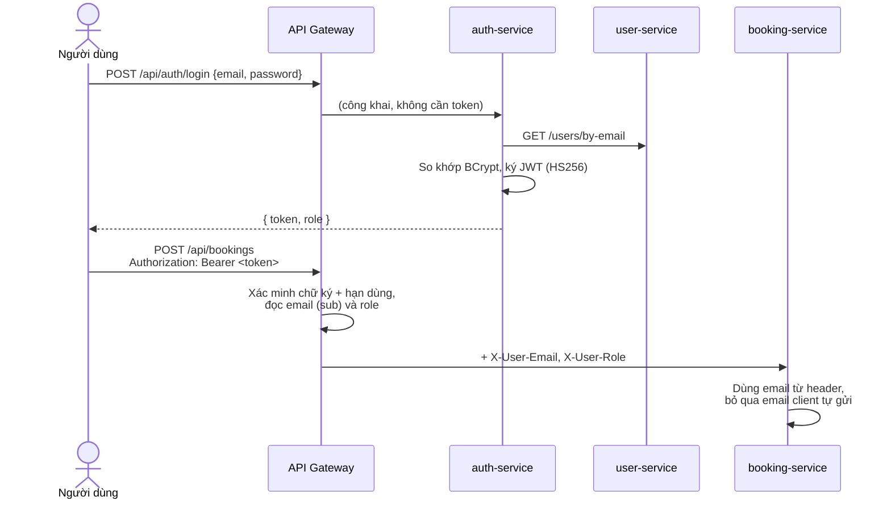

# Chương 5 – Định danh

## 5.1. Định danh node: tên miền trong mạng Docker (DNS)

Mỗi container được Docker cấp một **tên miền nội bộ** trùng tên service. Các service gọi nhau bằng tên, không cần biết địa chỉ IP (IP có thể đổi mỗi lần container khởi động lại):

```yaml
# docker-compose.yml
payment-service:
  environment:
    BOOKING_SERVICE_URL: http://booking-service:8082
    ROOM_SERVICE_URL: http://room-service:8083
```

Địa chỉ được truyền qua **biến môi trường**, không ghi cứng trong code. Khi chạy local không có Docker, giá trị mặc định là `http://localhost:<cổng>`.

## 5.2. Định danh người dùng: JWT



Nội dung token: `sub` = email, `role` = `ADMIN` / `CUSTOMER`, `exp` = 1 giờ. auth-service và api-gateway dùng chung khoá bí mật `JWT_SECRET`.

## 5.3. Kiểm tra quyền tại Gateway

[JwtAuthFilter.java](../services/api-gateway/src/main/java/com/example/apigateway/security/JwtAuthFilter.java) phân loại mọi request:

| Loại | Đường dẫn | Không token | Token CUSTOMER | Token ADMIN |
|---|---|---|---|---|
| Công khai | `/api/auth/**`, `POST /api/users`, `GET /api/rooms/**` | ✅ | ✅ | ✅ |
| Cần đăng nhập | các API còn lại | 401 | ✅ | ✅ |
| Quản trị | `GET /api/users`, `GET /api/bookings`, `/api/bookings/admin`, `PUT /api/bookings/*/confirm`, `/api/payments/revenue/**` | 401 | 403 | ✅ |
| Nội bộ | `/api/bookings/*/start-payment`, `/api/bookings/*/fail` | 403 | 403 | 403 |

Ngoài ra:

- Gateway **xoá** mọi header `X-User-Email`/`X-User-Role` client tự gửi, rồi mới gắn giá trị lấy từ token, nên không giả mạo được danh tính.
- booking-service dùng danh tính này để: ghi đúng chủ booking, chỉ trả lịch sử của chính người dùng, không cho huỷ booking của người khác (403).

Kết quả kiểm thử:

```
GET rooms (không token):            200
GET bookings/active (không token):  401
Token sai:                          401
GET users bằng token CUSTOMER:      403
GET users bằng token ADMIN:         200
PUT start-payment từ bên ngoài:     403
bob huỷ booking của alice:          403
```

## 5.4. Định danh tài nguyên: URI

Mỗi tài nguyên có một URI duy nhất theo kiểu REST: `/api/rooms/{id}`, `/api/bookings/{id}`, `/api/payments`. Khoá chính do database cấp (`IDENTITY`), mỗi service tự quản lý khoá của bảng mình.
