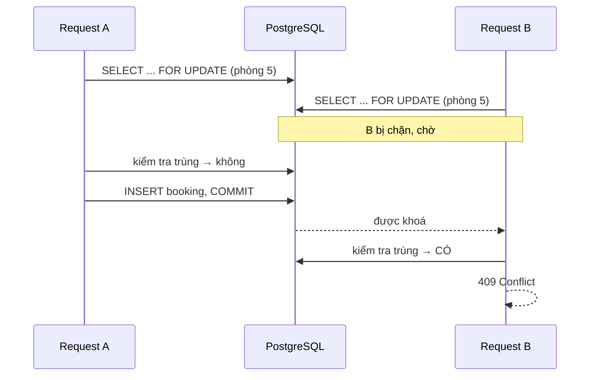

# Chương 6 – Đồng bộ hoá

## 6.1. Vấn đề: đặt trùng phòng

Phiên bản ban đầu lưu booking mà không kiểm tra lịch. Nếu chỉ thêm bước "kiểm tra rồi lưu", vẫn xảy ra **race condition**:

```
Request A: kiểm tra phòng 5 ngày 1–4 → trống
Request B: kiểm tra phòng 5 ngày 1–4 → trống
Request A: lưu booking
Request B: lưu booking   ← trùng phòng
```

Bước kiểm tra và bước lưu phải được thực hiện **nguyên tử** đối với các request cùng phòng.

## 6.2. Giải pháp 1 – Pessimistic locking theo phòng

booking-service có bảng `room_lock`, mỗi phòng một dòng. Khi đặt phòng ([BookingService.java](../services/booking-service/src/main/java/com/example/bookingservice/service/BookingService.java)):

```java
return tx.execute(status -> {
    roomLockRepository.lockByRoomId(roomId);          // SELECT ... FOR UPDATE
    if (bookingRepository.existsOverlap(roomId, checkIn, checkOut, HOLDING_STATUSES)) {
        throw new ResponseStatusException(HttpStatus.CONFLICT, "Phòng đã có người đặt...");
    }
    return bookingRepository.save(booking);
});                                                  // commit → nhả khoá
```

- Request đặt **cùng phòng** phải xếp hàng; request đặt **phòng khác** chạy song song bình thường.
- Khoá nằm ở **database dùng chung**, nên vẫn đúng khi chạy nhiều instance booking-service (khoá phân tán ở tầng database).
- Điều kiện trùng: hai khoảng `[a, b)` và `[c, d)` giao nhau khi `a < d` và `c < b`. Ngày trả phòng của khách trước bằng ngày nhận phòng của khách sau thì **không** tính là trùng.



**Kết quả kiểm thử** – 10 request đồng thời (2 tài khoản khác nhau) cùng đặt phòng 5, ngày 01–04/12:

```
1 × 200 OK
9 × 409 Conflict
Đặt tiếp ngày 04–06/12 (sát lịch cũ): 200 OK
```

## 6.3. Giải pháp 2 – Compare-and-set khi thanh toán

Khách bấm "thanh toán" hai lần liên tiếp có thể bị trừ tiền hai lần. payment-service phải **giữ quyền thanh toán** trước khi thu tiền:

```sql
UPDATE booking SET status = 'PAYING', version = version + 1
WHERE id = ? AND status = 'PENDING_PAYMENT'
```

Câu `UPDATE` là nguyên tử: chỉ request đầu tiên nhận kết quả "1 dòng"; request sau nhận "0 dòng" và bị trả về 409.

**Kết quả kiểm thử** – 2 request thanh toán đồng thời cho cùng booking: `1 × 200`, `1 × 409`, bảng `payment` chỉ có **1** bản ghi.

## 6.4. Giải pháp 3 – Optimistic locking

Entity `Booking` có trường `@Version`. Mỗi lần cập nhật, Hibernate sinh `UPDATE ... WHERE id = ? AND version = ?`. Nếu admin bấm "Duyệt" đúng lúc sự kiện thanh toán tới, bên ghi sau sẽ nhận lỗi thay vì ghi đè âm thầm; API trả 409 "Booking vừa được cập nhật bởi tiến trình khác".

| | Pessimistic | Optimistic |
|---|---|---|
| Cách làm | Khoá trước, làm sau | Làm trước, kiểm tra version khi ghi |
| Phù hợp | Tranh chấp cao (nhiều người đặt cùng phòng hot) | Tranh chấp thấp (sửa trạng thái một booking) |
| Dùng ở | Tạo booking | Đổi trạng thái booking |

## 6.5. Giải pháp 4 – Đồng bộ qua Message Queue: consumer idempotent

RabbitMQ đảm bảo **at-least-once**: một message có thể tới hơn một lần (ví dụ consumer xử lý xong nhưng chết trước khi gửi ack). booking-service xử lý sự kiện theo cách idempotent:

- Booking đã ở trạng thái đích (ví dụ đã `CONFIRMED`) → bỏ qua.
- Booking ở trạng thái không hợp lệ (ví dụ đã `CANCELLED`) → ghi log, không ném lỗi.

Nhờ đó cùng một kết quả thanh toán có thể đến từ RabbitMQ **và** từ đường REST dự phòng (Chương 8) mà không gây sai lệch.
