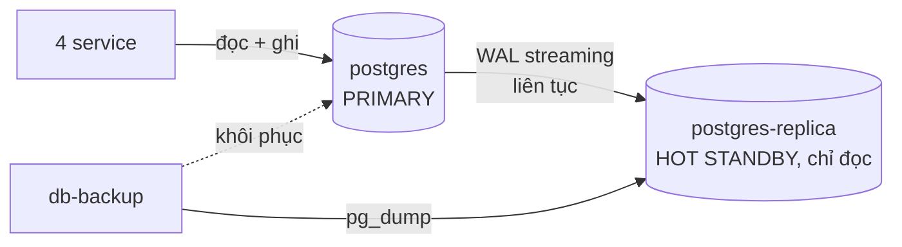

# Chương 7 – Sao lưu

Hệ thống dùng ba lớp bảo vệ dữ liệu bổ sung cho nhau:

| Lớp | Công cụ | Chống được |
|---|---|---|
| Dữ liệu bền vững | PostgreSQL + Docker volume | Tắt/khởi động lại container |
| **Data replication** | PostgreSQL streaming replication (primary → replica) | Hỏng máy/ổ đĩa của node primary |
| **Database backup tự động** | `pg_dump` định kỳ từ replica | Xoá nhầm, lỗi ứng dụng làm hỏng dữ liệu |

## 7.1. Dữ liệu bền vững

Phiên bản ban đầu dùng H2 in-memory: tắt service là mất dữ liệu. Hiện tại dữ liệu nằm trong **PostgreSQL 16**, mỗi service một database (`userdb`, `roomdb`, `bookingdb`, `paymentdb`), thư mục dữ liệu gắn vào Docker volume `pgdata`.

## 7.2. Data replication: một node ghi, một node đọc



- **Khởi tạo**: lần đầu chạy, replica sao chép toàn bộ dữ liệu từ primary bằng `pg_basebackup -R` ([replica-entrypoint.sh](../infra/postgres/replica-entrypoint.sh)).
- **Đồng bộ liên tục**: mọi thay đổi trên primary được ghi vào WAL và đẩy sang replica gần như tức thời.
- **Chỉ đọc**: replica từ chối ghi, đảm bảo chỉ có một nguồn sự thật.
- Primary giữ lại 256 MB WAL (`wal_keep_size`), nên replica tạm mất kết nối vẫn đuổi kịp được.

**Kết quả kiểm thử**:

```
primary:  select client_addr, state from pg_stat_replication → 172.23.0.8 | streaming
replica:  select pg_is_in_recovery()                         → true
primary bookings: 8, replica bookings: 8
ghi lên replica: ERROR: cannot execute DELETE in a read-only transaction
```

> **Replication không thay thế backup.** Xoá nhầm trên primary thì replica cũng bị xoá theo ngay lập tức (kiểm thử: xoá bảng booking trên primary → replica cũng còn 0 dòng). Vì vậy vẫn cần sao lưu định kỳ.

## 7.3. Sao lưu tự động

Container `db-backup` chạy [backup-loop.sh](../scripts/backup/backup-loop.sh), cứ mỗi `BACKUP_INTERVAL_SECONDS` giây (mặc định 3600) gọi [backup-once.sh](../scripts/backup/backup-once.sh):

```sh
pg_dump --clean --if-exists --no-owner -d "$DB" > "$DIR/$DB.sql" && gzip "$DIR/$DB.sql"
```

| Thiết lập | Giá trị | Ý nghĩa |
|---|---|---|
| Nguồn | **Replica** (`PGHOST=postgres-replica`) | Sao lưu không làm nặng node primary đang phục vụ ghi |
| Nơi lưu | `./backups/<yyyyMMdd-HHmmss>/<db>.sql.gz` trên máy host | Nằm ngoài container |
| Chu kỳ | `BACKUP_INTERVAL_SECONDS=3600` | Mất tối đa 1 giờ dữ liệu nếu phải khôi phục từ backup (RPO ≈ 1 giờ) |
| Giữ lại | `BACKUP_KEEP=24` | Tự xoá bản cũ |
| `--clean --if-exists` | | File backup tự xoá bảng cũ trước khi tạo lại, khôi phục đè lên được |

Sao lưu thủ công:

```powershell
docker compose exec db-backup sh /scripts/backup-once.sh
```

## 7.4. Khôi phục

Khôi phục luôn ghi vào **primary** (`RESTORE_HOST=postgres`); replica tự nhận lại dữ liệu qua replication.

```powershell
ls backups                                                        # 1. xem các bản
docker compose stop booking-service                               # 2. dừng service dùng DB đó
docker compose exec db-backup sh /scripts/restore.sh 20261114-115531 bookingdb   # 3. khôi phục
docker compose start booking-service                              # 4. chạy lại
```

**Kết quả kiểm thử**: 8 booking → sao lưu (từ replica) → xoá hết trên primary (primary 0, replica 0) → khôi phục → primary 8, replica 8.

## 7.5. Hướng mở rộng

- Đẩy thư mục `backups` lên lưu trữ đám mây (S3, Google Cloud Storage) để chống mất cả máy chủ.
- Tự động chuyển replica thành primary khi primary chết (Patroni, repmgr).
- Chuyển các truy vấn chỉ đọc nặng (thống kê doanh thu) sang replica.
