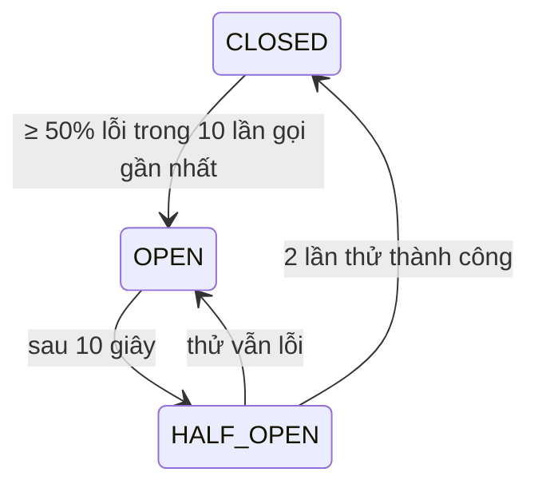

# Chương 8 – Tính chịu lỗi

Mục tiêu: một thành phần gặp sự cố thì phần còn lại vẫn phục vụ được, và thành phần đó tự hồi phục.

## 8.1. Health monitoring

Mọi service có Spring Boot Actuator: `GET /actuator/health` trả `{"status":"UP"}`. Docker gọi endpoint này mỗi 10 giây (`healthcheck` trong `docker-compose.yml`); trạng thái hiện trong `docker compose ps`:

```
booking-service   Up 5 minutes (healthy)
```

booking-service và payment-service còn hiển thị trạng thái circuit breaker: `GET /actuator/circuitbreakers`.

## 8.2. Tự khởi động lại

`restart: unless-stopped`: tiến trình chết (lỗi, hết bộ nhớ) thì Docker tự chạy lại. `depends_on: service_healthy` đảm bảo service chỉ khởi động khi các phụ thuộc đã sẵn sàng.

## 8.3. Timeout

Mọi lời gọi REST giữa service có timeout kết nối 2s, đọc 3s. Một service bị treo không giữ luồng của service gọi nó mãi mãi.

## 8.4. Retry

payment-service tự thử lại tối đa 3 lần (cách nhau 500ms) khi gọi booking-service/room-service gặp lỗi mạng hoặc lỗi 5xx. Không thử lại với lỗi 4xx (ví dụ booking không tồn tại) vì thử lại cũng không khác. Không thử lại `start-payment` vì thao tác này không idempotent.

## 8.5. Circuit breaker (Resilience4j)



Khi OPEN, lời gọi bị từ chối **ngay lập tức** (không chờ timeout), service gọi dùng phương án dự phòng:

| Nơi gọi | Circuit | Dự phòng khi room-service/booking-service chết |
|---|---|---|
| booking-service → room-service | `roomService` | Trang admin vẫn hiện danh sách booking, tên phòng ghi "N/A" |
| payment-service → booking/room | `bookingService`, `roomService` | Trả 503 "Hệ thống tạm thời gián đoạn", booking **không** bị chuyển sang PAYING nên khách thanh toán lại được sau |

**Kết quả kiểm thử** (tắt room-service):

```
GET /api/bookings/admin → 200, "roomName":"N/A"
circuit roomService      → "state":"OPEN"
POST /api/payments       → 503 "Không lấy được thông tin phòng"
booking vẫn ở trạng thái → PENDING_PAYMENT
```

## 8.6. Fallback khi message broker chết

Nếu không gửi được sự kiện lên RabbitMQ, payment-service chuyển sang gọi REST thẳng tới booking-service (`PUT /bookings/{id}/confirm` hoặc `/fail`). Vì booking-service xử lý idempotent (Chương 6), nếu sau này message cũng tới thì không gây sai lệch.

**Kết quả kiểm thử** (tắt RabbitMQ): thanh toán vẫn trả 200, booking chuyển `CONFIRMED`. Log:

```
WARN PaymentEventPublisher : Không gửi được sự kiện lên RabbitMQ (...), chuyển sang gọi REST trực tiếp
```

## 8.7. Dead-letter queue

Message xử lý lỗi 3 lần liên tiếp được chuyển sang `booking.payment-completed.dlq` thay vì lặp vô hạn hoặc bị bỏ. Quản trị viên xem tại http://localhost:15672 → Queues.

## 8.8. Tự huỷ booking treo

Booking bị bỏ dở ở `PENDING_PAYMENT` được job định kỳ huỷ sau 15 phút (Chương 3), để phòng không bị khoá mãi.

## 8.9. Hạn chế còn lại

- Mỗi service hiện chỉ chạy **một instance**; chưa có cân bằng tải và tự mở rộng (Nginx/HAProxy, Kubernetes HPA).
- Chưa có Prometheus/Grafana để vẽ biểu đồ theo thời gian, và chưa gom log tập trung (ELK).
- Nếu cả RabbitMQ **và** booking-service cùng chết đúng lúc thanh toán, booking nằm ở `PAYING` và cần xử lý tay (giải pháp đầy đủ: Transactional Outbox).
