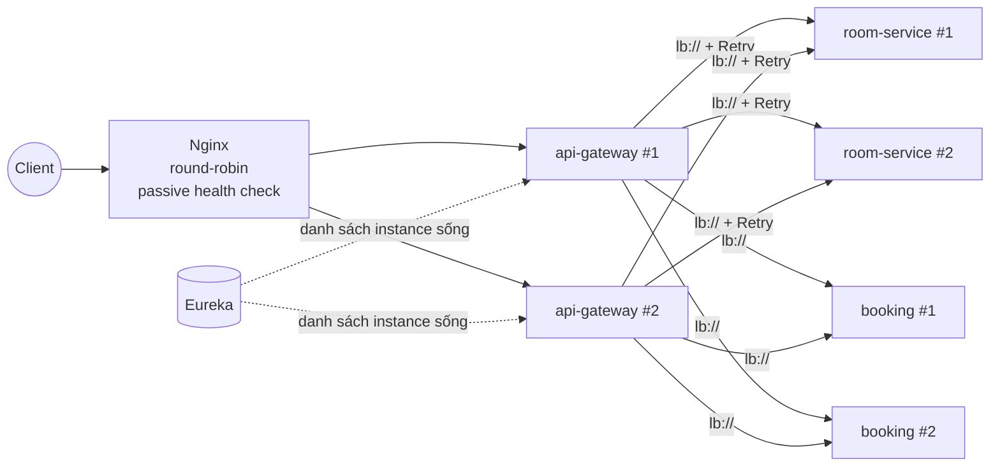
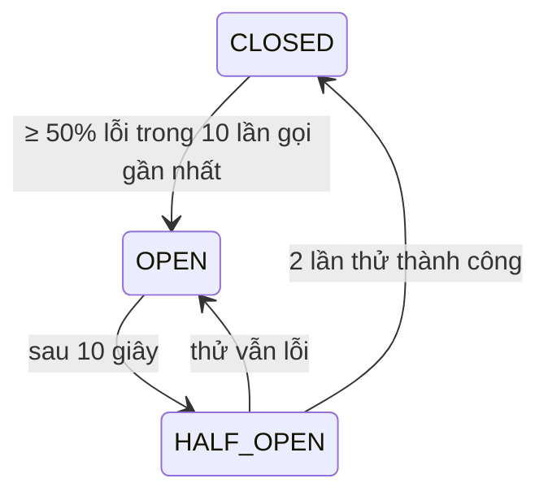

# Chương 8 – Tính chịu lỗi

Mục tiêu: một thành phần gặp sự cố thì phần còn lại vẫn phục vụ được, thành phần đó tự hồi phục, và người vận hành **nhìn thấy** chuyện gì đang xảy ra.

| Kỹ thuật (theo bảng điểm) | Cách làm trong hệ thống |
|---|---|
| Failover, Load Balancing | Nginx trước 2 api-gateway; Eureka + Spring Cloud LoadBalancer trước 2 room-service, 2 booking-service; retry sang instance khác |
| Circuit Breaking | Resilience4j |
| Health Monitoring | Actuator + Docker healthcheck; Prometheus + Grafana |
| Log Management | Loki + Promtail, xem trên Grafana |
| Tự phục hồi | Docker restart policy, Eureka loại instance chết, client WebSocket tự nối lại |

## 8.1. Load balancing và failover



**Tầng 1 – Nginx** ([load-balancer.conf](../infra/nginx/load-balancer.conf)): chia request xoay vòng giữa các IP của `api-gateway` (Docker DNS, phân giải lại mỗi 5 giây). Instance không kết nối được trong 1 giây thì bị loại 10 giây, request được chuyển sang instance khác (`proxy_next_upstream`). POST/PUT không bị gửi lại, nên không có nguy cơ đặt phòng hai lần.

**Tầng 2 – Gateway + Eureka**: `lb://room-service` chọn instance từ danh sách Eureka. Bộ lọc `Retry` thử lại tối đa 2 lần cho request GET gặp lỗi kết nối/502/503/504, mỗi lần thử sang instance khác. Timeout kết nối 0,5 giây, phản hồi 10 giây.

**Tầng 3 – Service gọi service**: `RestTemplate` có `@LoadBalanced` cùng retry của Resilience4j trong payment-service.

**Kết quả kiểm thử**:

```
6 lần GET /api/rooms/1 → X-Served-By luân phiên room-service@0e69…, room-service@9bc1…
                         X-Gateway-Upstream luân phiên 172.23.0.12, 172.23.0.9

docker kill room-service-1    → 30/30 request thành công (20/20 ở lần thử khác)
docker kill booking-service-2 → 10/10 GET thành công, đặt phòng vẫn 200
docker kill api-gateway-1     → 29/30 thành công, 1 request bị 504
```

Request lỗi khi gateway chết là request đang được gửi tới đúng instance vừa chết, trước khi Nginx kịp đánh dấu nó lỗi (cơ chế phát hiện thụ động). Nginx bản thương mại hoặc HAProxy có health check chủ động sẽ khắc phục được.

## 8.2. Health monitoring – Prometheus + Grafana

Mọi service xuất metrics tại `/actuator/prometheus` (Micrometer). **Prometheus tự tìm target qua Eureka** ([prometheus.yml](../infra/prometheus/prometheus.yml)): bật thêm replica thì instance mới tự xuất hiện, không phải sửa cấu hình.

Dashboard **"Hotel Booking – Giám sát hệ thống"** (http://localhost:3000, tự mở khi vào Grafana, tài khoản admin/admin), 17 panel:

| Nhóm | Panel |
|---|---|
| Tổng quan | Số instance đang chạy theo service; request/giây; độ trễ p95 |
| Cân bằng tải | Request/giây theo **từng instance** (thấy tải chia đều); lỗi 5xx/giây |
| Tài nguyên JVM | Heap, CPU theo instance |
| Chịu lỗi, cache, khoá | Trạng thái circuit breaker (CLOSED/OPEN); Redis cache hit/miss; số lần khoá Redis vs database; message RabbitMQ xử lý/giây |
| Log | Log WARN/ERROR toàn hệ thống; log nghiệp vụ |

Ngoài ra Docker kiểm tra `/actuator/health` mỗi 10 giây; trạng thái hiện trong `docker compose ps`.

## 8.3. Log management – Loki

Trước đây log nằm rải rác trong 21 container. **Promtail** đọc log mọi container qua Docker API, gắn nhãn `service`, `container`, `level` rồi đẩy về **Loki**. Tìm log toàn hệ thống ở một chỗ: Grafana → Explore → Loki, ví dụ:

```
{service="booking-service"} |= "Nhận sự kiện thanh toán"
{service=~".+"} | level="WARN"
{service="room-service"} |= "Cache miss"
```

## 8.4. Tự khởi động lại

`restart: unless-stopped`: tiến trình chết thì Docker tự chạy lại. Kiểm thử: giết JVM bên trong room-service (`kill 1`) → `RestartCount=1`, container chạy lại, đăng ký lại Eureka. (Lệnh `docker kill`/`docker stop` được Docker coi là dừng chủ động nên không tự khởi động lại.)

## 8.5. Timeout và retry

- Gọi service khác: kết nối 0,5s, đọc 3s.
- payment-service thử lại tối đa 3 lần khi gặp lỗi mạng/5xx; không thử lại lỗi 4xx; không thử lại `start-payment` (không idempotent).

## 8.6. Circuit breaker (Resilience4j)



| Nơi gọi | Dự phòng khi phía sau chết |
|---|---|
| booking-service → room-service | Trang admin vẫn hiện booking, tên phòng "N/A" |
| payment-service → booking/room | Trả 503, booking **không** chuyển sang PAYING nên khách thanh toán lại được |

## 8.7. Suy giảm có kiểm soát khi hạ tầng phụ lỗi

| Thành phần chết | Hệ thống phản ứng | Kết quả kiểm thử |
|---|---|---|
| **Redis** | Cache: đọc thẳng PostgreSQL. Khoá: chuyển sang `SELECT FOR UPDATE`, bỏ qua Redis 10 giây | Đặt phòng đồng thời vẫn `1×200, 9×409`; đợt thứ hai xong trong 0,5s; Redis sống lại tự quay về khoá Redis |
| **RabbitMQ** | payment-service gọi REST thẳng booking-service; WebSocket chỉ báo được cho client cùng instance | Thanh toán vẫn 200, booking `CONFIRMED` |
| **Một instance bất kỳ** | Load balancer + Eureka chuyển sang instance còn lại | Mục 8.1 |
| **PostgreSQL primary** | Replica còn nguyên dữ liệu (chuyển đổi bằng tay) | Chương 7 |

Message xử lý lỗi 3 lần được chuyển sang dead-letter queue `booking.payment-completed.dlq` thay vì bị bỏ.

## 8.8. Hạn chế còn lại

- Eureka, Nginx load balancer, Redis, RabbitMQ, PostgreSQL primary mỗi thứ chỉ có **một** bản: vẫn là điểm lỗi đơn. Hệ thống thật cần cụm (Eureka peer, Keepalived + 2 Nginx, Redis Sentinel, RabbitMQ cluster, Patroni).
- Chưa tự mở rộng theo tải (Kubernetes HPA); số replica cố định trong `docker-compose.yml`.
- Khi một instance chết đột ngột, có tới khoảng 20 giây request phải thử lại (Eureka cần 15 giây để loại instance), nên chậm hơn bình thường dù vẫn thành công.
- Nếu cả RabbitMQ **và** booking-service cùng chết đúng lúc thanh toán, booking nằm ở `PAYING` và cần xử lý tay (giải pháp đầy đủ: Transactional Outbox).
